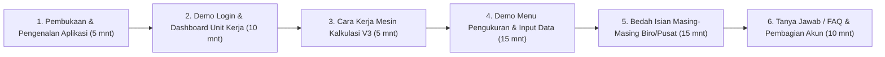
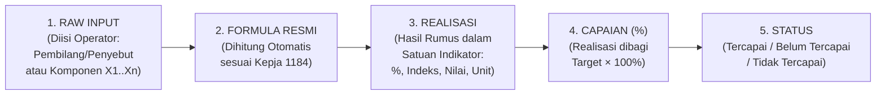

# Panduan Paparan & Naskah Live Demo Aplikasi E-Laptri (e-LKjIP JAMBIN V3)
**Peserta Rapat:** Seluruh Operator Biro dan Pusat di Lingkungan JAMBIN  
**Metode Paparan:** *Live Demo* (Menampilkan Aplikasi Langsung Tanpa Slide)  
**Dasar Regulasi:** Renstra Kejaksaan RI 2025–2029 & Kepja Nomor 1184 Tahun 2025 (IKU 2025–2029)

---

> [!TIP]
> **Cara Menggunakan Dokumen Ini Besok:**
> Buka dokumen ini di layar kedua, tablet, atau ponsel Anda saat melakukan *Share Screen* aplikasi **E-Laptri JAMBIN**. Urutan di bawah ini sudah disusun **persis mengikuti alur klik layar aplikasi dari awal (Login) hingga akhir (Simpan Data)**, dilengkapi kalimat yang bisa langsung Anda ucapkan (*Talking Points*), daftar lengkap isian tiap Biro/Pusat, dan sontekan jawaban **FAQ** ketika operator bertanya.

---

## BAGIAN 1: Susunan Acara & Alur *Live Demo* (Estimasi 45–60 Menit)

---

## BAGIAN 2: Naskah Bicara (*Talking Points*) & Panduan Klik Layar

### Sesi 1 — Pembukaan: Aplikasi Apa Ini & Mengapa Kita Menggunakannya?
*(Kondisi Layar: Tampilkan Halaman **Login** aplikasi E-Laptri JAMBIN)*

**Apa yang harus Anda bicarakan:**
1. **Sapaan & Konteks Rapat:**
   > *"Selamat pagi/siang rekan-rekan Operator dari seluruh Biro dan Pusat di lingkungan JAMBIN. Hari ini kita berkumpul khusus sesama operator teknis untuk menyamakan persepsi dan mempraktikkan langsung tata cara penggunaan aplikasi **E-Laptri (e-LKjIP Pembinaan) Versi Arsitektur V3**."*
2. **Apa itu Aplikasi E-Laptri JAMBIN?**
   > *"Aplikasi ini adalah sistem pengukuran dan pelaporan kinerja triwulanan (Laporan Triwulan / Laptri) dan tahunan (LKjIP) Bidang Pembinaan yang sudah disesuaikan **100% dengan Renstra Kejaksaan RI 2025–2029 dan Kepja Nomor 1184 Tahun 2025 tentang IKU**."*
3. **Apa Bedanya Sistem Ini (Arsitektur V3) dengan Cara Lama/Manual?**
   > *"Di sistem ini, rekan-rekan Operator **tidak perlu lagi menghitung rumus secara manual di Excel**, tidak perlu menebak-nebak target, dan tidak perlu pusing menghitung persentase capaian. Tugas Operator hanya dua: **memasukkan angka komponen mentah (seperti Pembilang/Penyebut atau variabel komponen)** serta **mengisi narasi analisis kualitatif**. Begitu klik Simpan, mesin kalkulasi aplikasi yang akan menghitung **Realisasi**, membandingkannya dengan **Target resmi**, mengeluarkan **% Capaian**, hingga menentukan **Status Ketercapaiannya** secara otomatis."*

---

### Sesi 2 — Cara Kerja Aplikasi & Hak Akses Operator Biro/Pusat
*(Kondisi Layar: Login menggunakan salah satu akun Operator, misalnya `ro.ren` untuk Biro Perencanaan atau `ro.kap` untuk Biro Perlengkapan, lalu tampilkan halaman **Dashboard Kinerja**)*

**Daftar Akun Operator Biro/Pusat (Untuk Dibagikan Saat Rapat):**

| Kode Unit | Nama Biro / Pusat | Username Operator | Kode Bidang |
| :--- | :--- | :--- | :--- |
| `RO-REN` | Biro Perencanaan | `ro.ren` | `REN` |
| `RO-PEG` | Biro Kepegawaian | `ro.peg` | `PEG` |
| `RO-KEU` | Biro Keuangan | `ro.keu` | `KEU` |
| `RO-KAP` | Biro Perlengkapan | `ro.kap` | `KAP` |
| `RO-HUK-HLN` | Biro Hukum dan Hubungan Luar Negeri | `ro.huk.hln` | `HLN` |
| `RO-UMUM` | Biro Umum | `ro.umum` | `UMUM` |
| `PUSDASKRIMTI` | Pusat Data Statistik Kriminal dan TI | `pusdaskrimti` | `PDTI` |
| `PUSTRAJAKGAKUM` | Pusat Strategi Kebijakan Penegakan Hukum | `pustrajakgakum` | `PSKPH` |
| `PKY` | Pusat Kesehatan Yustisial | `pky` | `PKY` |
| `SET-JAMBIN` | Sekretariat JAMBIN | `set.jambin` | `SET` |

**Apa yang harus Anda tunjukkan di layar & bicarakan:**
1. **Isolasi Data per Biro/Pusat (Keamanan & Fokus Kerja):**
   * *Tunjuk kotak identitas di Sidebar kiri atas (di bawah logo E-Laptri JAMBIN).*
   * **Bicara:** *"Setiap Biro dan Pusat memiliki 1 akun Operator khusus. Saat rekan-rekan login, aplikasi otomatis mengunci tampilan **hanya pada indikator milik Biro/Pusat rekan-rekan sendiri**. Jadi Biro Keuangan tidak akan melihat atau tidak sengaja mengubah isian Biro Kepegawaian, begitu pula sebaliknya."*
2. **Apa Saja yang Dapat Dilakukan oleh Operator?**
   * *Tunjuk menu di Sidebar kiri (`Dashboard Kinerja`, `Pengukuran & Input Data`) dan menu Profil di kanan atas/bawah.*
   * **Bicara:** *"Sebagai Operator, ruang lingkup kerja rekan-rekan sangat ringkas dan jelas, terdiri dari 3 hal utama:*
     1. *Memantau progres keterisian dan ketercapaian indikator unit kerja di menu **Dashboard Kinerja** per Tahun dan Triwulan (TW I s.d. TW IV).*
     2. *Menginput angka variabel kinerja dan analisis kualitatif pada menu **Pengukuran & Input Data**.*
     3. *Mengelola kata sandi/profil akun pada menu **Pengaturan Profil**.*
     *Sedangkan untuk perubahan rumus, penguncian target, validasi laporan, dan ekspor dokumen LKjIP Word menjadi kewenangan Admin JAMBIN."*
3. **Penjelasan Elemen pada Halaman `Dashboard Kinerja`:**
   * *Klik tombol pindah Triwulan (TW 1, TW 2, TW 3, TW 4) di bagian atas Dashboard, lalu scroll ke bawah menunjukkan kartu KPI, Diagram Lingkaran (Donut Chart), dan Diagram Batang (Bar Chart).*
   * **Bicara:** *"Di halaman Dashboard ini, sebelum atau sesudah menginput data, rekan-rekan bisa langsung melihat:*
     * *Berapa total Sasaran Program (SP) dan Indikator Kinerja Kegiatan (IKK) yang menjadi tanggung jawab Biro/Pusat rekan-rekan;*
     * *Berapa indikator yang **Sudah Diisi** vs **Belum Diisi** (Donut Chart kanan);*
     * *Berapa indikator yang berstatus **Tercapai**, **Belum Tercapai**, atau **Tidak Tercapai** (Donut Chart kiri);*
     * *Serta grafik perbandingan capaian antar Sasaran Kegiatan (SK) dan antar IKK di bagian bawah."*

---

### Sesi 3 — Bagaimana Cara Bekerjanya Mesin Perhitungan Aplikasi? (Wajib Ditekankan!)
*(Kondisi Layar: Klik menu **`Pengukuran & Input Data`** di Sidebar kiri)*

> [!IMPORTANT]
> **Poin Kunci yang Harus Dijelaskan ke Operator:**
> Banyak operator di sistem lama sering bingung antara **Input Mentah (Pembilang/Komponen)**, **Realisasi**, **Target**, dan **Capaian (%)**. Jelaskan alur 5 langkah ini sambil menunjuk salah satu kartu indikator di layar.

**Apa yang harus Anda bicarakan sambil menunjuk layar:**
1. **Pemisahan Realisasi vs Capaian:**
   > *"Perhatikan cara kerja aplikasi ini. Misalnya sebuah indikator menargetkan **85%**, dan dari hasil pembilang dibagi penyebut yang rekan-rekan input diperoleh hasil **84%**. Maka:*
   > * ***Realisasi*** *adalah **84%** (hasil murni dari rumus indikator).*
   > * ***Target*** *adalah **85%** (angka patokan dari Renstra/Kepja 1184 yang sudah dikunci di sistem).*
   > * ***Capaian terhadap Target*** *adalah `(84 / 85) × 100% = 98,82%`.*
   > *Jadi rekan-rekan **jangan memasukkan hasil persentase ke dalam kolom pembilang**, melainkan masukkan angka riilnya (jumlah yang selesai dibagi total populasi/target layanan)."*
2. **Aturan Status Ketercapaian (TW 1–3 vs TW 4):**
   > *"Sistem juga otomatis memberikan label status di pojok kanan atas kartu indikator:*
   > * *Jika Capaian **$\ge$ 100%** $\rightarrow$ otomatis hijau bertuliskan **`TERCAPAI`**.*
   > * *Jika Capaian **< 100%** pada **Triwulan 1, 2, atau 3** $\rightarrow$ otomatis kuning bertuliskan **`BELUM_TERCAPAI`** (karena tahun anggaran masih berjalan dan masih bisa dikejar di triwulan berikutnya).*
   > * *Jika Capaian **< 100%** pada **Triwulan 4** $\rightarrow$ otomatis merah bertuliskan **`TIDAK_TERCAPAI`**."*
3. **Indikator IKP Bersifat Mandiri (Tidak Merata-rata IKK di Bawahnya secara Sembarangan):**
   > *"Di versi terbaru ini, pengisian **IKP (Indikator Sasaran Program)** dan **IKK (Indikator Kinerja Kegiatan)** dipisahkan pada dua Tab yang berbeda. Mengapa? Karena sesuai Kepja 1184 Tahun 2025, setiap IKP memiliki rumus dan variabel komponennya sendiri (bersifat **MANDIRI**), **bukan** sekadar rata-rata kasar dari seluruh IKK di bawahnya."*

---

### Sesi 4 — Demo Langkah demi Langkah Mengisi Data di Menu `Pengukuran & Input Data`
*(Kondisi Layar: Tetap di halaman **`Pengukuran & Input Data`**)*

**Urutan Elemen Layar yang Harus Anda Tunjukkan Satu per Satu:**

1. **Langkah 1: Pilih Tahun dan Triwulan (Kotak Kanan Atas pada Banner Gelap)**
   * *Tunjuk dropdown `TAHUN` (2025–2029) dan `TRIWULAN` (Triwulan 1 s.d. Triwulan 4).*
   * **Bicara:** *"Langkah pertama setiap kali akan menginput data: pastikan **Tahun** dan **Triwulan** di pojok kanan atas ini sudah sesuai dengan periode yang ingin diisi. Jika Anda mengganti Triwulan, halaman akan otomatis memuat data triwulan tersebut."*

2. **Langkah 2: Perhatikan Tab Level Indikator (`IKK` vs `IKP`)**
   * *Tunjuk tombol Tab switching di bawah banner (Tab **Indikator Kinerja Kegiatan (IKK)** dan Tab **Indikator Sasaran Program (IKP)**).*
   * **Bicara:** *"Bagi Biro/Pusat yang mengampu kedua level indikator (seperti Biro Perencanaan, Biro Kepegawaian, Biro Keuangan, Biro Perlengkapan, Biro Hukum & HLN, Pusdaskrimti, dan PKY), di sini akan muncul **2 Tab**: Tab **IKK** dan Tab **IKP**. Pastikan rekan-rekan mengecek dan mengisi keduanya. Sedangkan untuk Biro Umum dan Pustrajakgakum yang hanya mengampu IKK, sistem otomatis langsung menampilkan daftar IKK-nya."*

3. **Langkah 3: Gunakan Fitur Pencarian & Buka/Tutup (*Expand/Collapse*) Kelompok Sasaran**
   * *Tunjuk kolom pencarian (`Cari kode atau nama indikator...`) dan tombol `Buka Semua` / `Tutup Semua`, lalu klik bar akordion Sasaran Program (`SP`) dan Sasaran Kegiatan (`SK`).*
   * **Bicara:** *"Agar tampilan tidak menumpuk, indikator dikelompokkan secara rapi berdasarkan **Sasaran Program (SP)** dan **Sasaran Kegiatan (SK)**. Rekan-rekan bisa mengetik kata kunci atau kode indikator di kolom pencarian, atau menekan `Tutup Semua` / `Buka Semua` untuk memudahkan navigasi."*

4. **Langkah 4: Membaca Kartu Indikator & Petunjuk Rumus (Kotak Hijau)**
   * *Tunjuk satu kartu indikator (misalnya `IKK 1.3.1` atau `IKP 5.1`), tunjuk deretan badge di atas kartu (`Kode`, `Tipe Rumus`, `Satuan`, `Target`), lalu tunjuk kotak hijau `Formula Perhitungan`.*
   * **Bicara:** *"Pada setiap kartu indikator, di bagian atas sudah tertera kode, tipe perhitungan, satuan, serta **Target resmi** tahun tersebut. Di bawahnya terdapat kotak hijau **Formula Perhitungan** yang mengutip langsung rumus resmi dari Kepja 1184 Tahun 2025. Jadi operator tidak perlu membuka buku Kepja lagi saat menginput."*

5. **Langkah 5: Mengisi Kolom Variabel Input Formula (Kotak Putih Berpetunjuk)**
   * *Tunjuk kolom-kolom input angka beserta kotak informasi kecil di bawah masing-masing kolom input (kotak hijau untuk Pembilang, kotak biru untuk Penyebut, atau kotak abu-abu untuk Komponen/Realisasi).*
   * **Bicara:** *"Perhatikan kolom input angkanya. Di aplikasi ini terdapat **4 pola isian angka** tergantung jenis indikatornya:*
     * **Pola A — Rasio / Persentase (Pembilang & Penyebut):** *Terdapat 2 kolom. Di bawah kolom kiri (kotak hijau) sudah dijelaskan apa **Pembilang**-nya (misalnya: jumlah layanan selesai sesuai SLA), dan di bawah kolom kanan (kotak biru) dijelaskan apa **Penyebut**-nya (misalnya: total layanan dalam 1 tahun). Cukup ketik angkanya saja, **penyebut tidak boleh 0**.*
     * **Pola B — Komponen Terbobot / Penjumlahan / Rata-rata Komponen (`X1..Xn`):** *Khusus beberapa IKP (seperti Indeks Pengelolaan Aset `X1..X8` di Biro Perlengkapan, NKA `X1..X2` di Biro Keuangan, Indeks Profesionalitas SDM `X1..X4` di Biro Kepegawaian, atau Indeks Kepuasan Layanan Internal 8 Biro di Biro Perencanaan), aplikasi menampilkan kolom sesuai jumlah komponennya lengkap dengan keterangan bobotnya.*
     * **Pola C — Indeks Survei (`SURVEY_INDEX`):** *Memasukkan **Total Skor Aktual Hasil Survei** dan **Total Skor Ideal/Maksimal** (Responden $\times$ Pertanyaan $\times$ Skala Maksimal).*
     * **Pola D — Nilai Langsung / Skor Resmi Eksternal (`DIRECT_VALUE` / `EXTERNAL_SCORE`):** *Hanya 1 kolom input, digunakan untuk nilai resmi hasil evaluasi instansi eksternal (seperti Nilai SAKIP dari KemenPAN-RB, Indeks Sistem Merit dari BKN/KASN, IKK dari LAN RI, IPPN dari Bappenas) atau indikator berjenis jumlah mutlak (seperti jumlah RS Adhyaksa atau jumlah kegiatan PKY).*
   * **Tips Input Desimal:** *"Jika angkanya memiliki koma/desimal (misalnya `3,65`), rekan-rekan boleh mengetik menggunakan tanda **koma (`,`)** maupun **titik (`.`)**—sistem otomatis menormalisasikannya."*

6. **Langkah 6: Mengisi 3 Kolom Analisis Kualitatif & Rekomendasi**
   * *Tunjuk 3 kolom teks multiline di bagian bawah kartu: `Analisis Capaian Kinerja`, `Kendala / Hambatan`, dan `Upaya / Rencana Tindak Lanjut`.*
   * **Bicara:** *"Di bawah kolom angka, setiap indikator dilengkapi 3 kolom narasi kualitatif:*
     1. ***Analisis Capaian Kinerja:*** *Uraikan penjelasan mengapa capaian tersebut berhasil diraih atau faktor pendukungnya.*
     2. ***Kendala / Hambatan:*** *Tuliskan permasalahan teknis, regulasi, anggaran, atau SDM yang dihadapi selama triwulan tersebut.*
     3. ***Upaya / Rencana Tindak Lanjut:*** *Tuliskan langkah konkret atau strategi perbaikan yang dilakukan untuk triwulan berikutnya.*
     *Ketiga narasi ini sangat penting karena akan **ditarik langsung ke dalam draf laporan LKjIP/Laptri format Word** oleh Admin."*

7. **Langkah 7: Dua Cara Menyimpan Data (Simpan Mandiri vs Simpan Semua)**
   * *Tunjuk tombol **`Simpan & Hitung Kinerja`** di pojok kanan bawah kartu indikator, lalu tunjuk bar melayang (**Sticky Action Bar**) di bagian paling bawah layar.*
   * **Bicara:** *"Kami menyediakan dua tombol simpan untuk kenyamanan rekan-rekan:*
     * *Pertama, tombol **`Simpan & Hitung Kinerja`** di setiap kartu indikator: gunakan tombol ini jika Anda baru selesai mengisi **satu indikator** dan ingin langsung menyimpan serta melihat hasil hitungan Realisasi, Capaian %, dan Statusnya detik itu juga tanpa me-reload seluruh halaman.*
     * *Kedua, tombol **`Simpan Semua Perubahan`** pada bar melayang di bagian bawah layar: gunakan jika Anda mengisi banyak indikator sekaligus dan ingin menyimpan semuanya dalam satu kali klik."*

---

## BAGIAN 3: Rincian Lengkap Apa Saja yang Harus Diisi oleh Masing-Masing Biro & Pusat

> [!NOTE]
> Bagian ini adalah **pegangan utama Anda saat membedah masing-masing Biro/Pusat** di layar. Anda dapat menyebutkan ringkasan beban indikator tiap Biro/Pusat terlebih dahulu, lalu membacakan/menampilkan detail kolom isian mereka.

### Ringkasan Beban Indikator per Unit Kerja (Biro / Pusat)

| No | Unit Kerja (Biro / Pusat) | Akun Login | Jumlah IKP | Jumlah IKK | Total Indikator |
| :---: | :--- | :--- | :---: | :---: | :---: |
| 1 | **Biro Perencanaan** | `ro.ren` | 4 IKP | 12 IKK | **16 Indikator** |
| 2 | **Biro Kepegawaian** | `ro.peg` | 5 IKP | 10 IKK | **15 Indikator** |
| 3 | **Biro Keuangan** | `ro.keu` | 1 IKP | 8 IKK | **9 Indikator** |
| 4 | **Biro Perlengkapan** | `ro.kap` | 3 IKP | 17 IKK | **20 Indikator** |
| 5 | **Biro Hukum dan Hubungan Luar Negeri** | `ro.huk.hln` | 4 IKP | 7 IKK | **11 Indikator** |
| 6 | **Biro Umum** | `ro.umum` | 0 IKP | 7 IKK | **7 Indikator** |
| 7 | **Pusdaskrimti** | `pusdaskrimti` | 1 IKP | 11 IKK | **12 Indikator** |
| 8 | **Pustrajakgakum** | `pustrajakgakum` | 0 IKP | 8 IKK | **8 Indikator** |
| 9 | **Pusat Kesehatan Yustisial (PKY)** | `pky` | 1 IKP | 5 IKK | **6 Indikator** |
| 10 | **Lintas JAMBIN / Sekretariat** | `admin.jambin` / `set.jambin` | 0 IKP | 8 IKK | **8 Indikator** |

---

### 1. BIRO PERENCANAAN (`ro.ren`) — 4 IKP & 12 IKK

#### A. Tab IKP (Indikator Sasaran Program) — 4 Indikator:
1. **`IKP 1.1` — Nilai SAKIP Kejaksaan RI** *(Satuan: Nilai | Target 2025: 72, 2026: 73 | Tipe: Skor Resmi Eksternal / Tahunan)*
   * **Isian Angka (1 Kolom):** `Nilai SAKIP hasil evaluasi resmi` *(Nilai evaluasi AKIP resmi dari Kementerian PAN-RB, rentang 0–100)*.
2. **`IKP 6.1` — Nilai Evaluasi Kelembagaan** *(Satuan: Nilai | Target 2025: 80, 2026: 81 | Tipe: Penjumlahan Komponen `SUM`)*
   * **Isian Angka (2 Kolom):**
     * `X1`: Nilai dimensi struktur setelah pembobotan
     * `X2`: Nilai dimensi proses organisasi setelah pembobotan
3. **`IKP 6.2` — Tingkat Kepatuhan Satker terhadap SOP** *(Satuan: Persentase | Target 2025: 80%, 2026: 85% | Tipe: Rasio Persentase)*
   * **Isian Angka (2 Kolom):**
     * **Pembilang:** `Jumlah satker yang patuh terhadap SOP` (angka bulat)
     * **Penyebut:** `Jumlah satker yang dinilai kepatuhannya` (angka bulat, minimal 1)
4. **`IKP 10.1` — Indeks Kepuasan Layanan Dukungan Internal** *(Satuan: Indeks | Target 2025: 3,6, 2026: 3,7 | Tipe: Rata-rata 8 Komponen Layanan)*
   * **Isian Angka (8 Kolom Indeks Layanan):**
     * `IKL_REN`: Indeks Kepuasan Layanan Perencanaan
     * `IKL_KEU`: Indeks Kepuasan Layanan Keuangan
     * `IKL_PEG`: Indeks Kepuasan Layanan Kepegawaian
     * `IKL_LOG`: Indeks Kepuasan Layanan Perlengkapan/Pengadaan
     * `IKL_ORG`: Indeks Kepuasan Layanan Organisasi & Tata Laksana
     * `IKL_HKM`: Indeks Kepuasan Layanan Hukum & Kerja Sama
     * `IKL_TI`: Indeks Kepuasan Layanan TI & Statistik Kriminal
     * `IKL_UMM`: Indeks Kepuasan Layanan Umum, Protokol & RT

#### B. Tab IKK (Indikator Kinerja Kegiatan) — 12 Indikator:
| Kode IKK | Sasaran Kegiatan (SK) | Nama Indikator | Satuan & Target (2025 / 2026) | Bentuk Isian yang Harus Diinput Operator |
| :--- | :--- | :--- | :--- | :--- |
| **`IKK 1.2.1`** | SK 1.2 | Indeks Perencanaan Pembangunan Nasional (IPPN) | Indeks (`93` / `93,5`) | **1 Kolom Nilai Langsung:** Nilai Realisasi Aktual IPPN |
| **`IKK 1.3.1`** | SK 1.3 | Persentase layanan pengelolaan data sesuai SLA | Persentase (`100%` / `100%`) | **Rasio (2 Kolom):** • **Pembilang:** Jumlah layanan pengelolaan data yang diselesaikan sesuai SLA • **Penyebut:** Total layanan pengelolaan data dalam 1 tahun |
| **`IKK 1.3.2`** | SK 1.3 | Persentase layanan penyusunan rencana anggaran dan program kerja sesuai SLA | Persentase (`100%` / `100%`) | **Rasio (2 Kolom):** • **Pembilang:** Jumlah dokumen rencana anggaran & program kerja yang disusun sesuai SLA • **Penyebut:** Jumlah total dokumen yang harus disusun dalam 1 tahun |
| **`IKK 1.3.3`** | SK 1.3 | Persentase layanan pemantauan dan evaluasi sesuai SLA | Persentase (`100%` / `100%`) | **Rasio (2 Kolom):** • **Pembilang:** Jumlah layanan monev yang dilaksanakan sesuai SLA • **Penyebut:** Jumlah total layanan monev dalam 1 tahun |
| **`IKK 1.3.4`** | SK 1.3 | Persentase layanan organisasi dan tata laksana sesuai SLA | Persentase (`100%` / `100%`) | **Rasio (2 Kolom):** • **Pembilang:** Jumlah layanan organisasi dan tata laksana yang dilaksanakan sesuai SLA • **Penyebut:** Jumlah total layanan organisasi dan tata laksana dalam 1 tahun |
| **`IKK 1.3.5`** | SK 1.3 | Persentase layanan reformasi birokrasi sesuai SLA | Persentase (`100%` / `100%`) | **Rasio (2 Kolom):** • **Pembilang:** Jumlah layanan reformasi birokrasi yang diselesaikan sesuai SLA • **Penyebut:** Jumlah total layanan reformasi birokrasi dalam 1 tahun |
| **`IKK 1.3.6`** | SK 1.3 | Persentase satker Kejaksaan RI yang mendapat pendampingan pembangunan ZI menuju WBK/WBBM | Persentase (`35%` / `40%`) | **Rasio (2 Kolom):** • **Pembilang:** Jumlah satker yang mendapat pendampingan • **Penyebut:** Jumlah total satker yang membangun ZI |
| **`IKK 6.1.1`** | SK 6.1 | Persentase Penyelesaian Restrukturisasi Organisasi | Persentase (`80%` / `85%`) | **Rasio (2 Kolom):** • **Pembilang:** Jumlah dokumen restrukturisasi yang telah selesai disusun • **Penyebut:** Jumlah total rencana/target restrukturisasi yang ditetapkan dalam 1 tahun |
| **`IKK 6.1.2`** | SK 6.1 | Tingkat Realisasi Rencana Aksi RB General Kejaksaan RI | Persentase (`80%` / `85%`) | **Rasio (2 Kolom):** • **Pembilang:** Jumlah aksi RB yang telah dilaksanakan • **Penyebut:** Jumlah total aksi RB yang direncanakan dalam 1 tahun |
| **`IKK 6.2.1`** | SK 6.2 | Persentase implementasi RB UKE I berdasarkan Rencana Aksi RB Tematik | Persentase (`80%` / `85%`) | **Rasio (2 Kolom):** • **Pembilang:** Jumlah aksi RB tematik yang telah dilaksanakan • **Penyebut:** Jumlah total aksi RB tematik yang direncanakan dalam 1 tahun |
| **`IKK 8.2.2`** *(Kontributor)* | SK 8.2 | Tingkat kesesuaian pengelolaan SDM Jaksa | Persentase (`80%` / `85%`) | **Rasio (2 Kolom):** Pembilang & Penyebut sesuai realisasi komponen pengelolaan SDM (bersama Biro Kepegawaian) |
| **`IKK 10.8.1`** | SK 10.8 | Persentase Satker yang melaksanakan Survey kepuasan layanan | Persentase (`100%` / `100%`) | **Rasio (2 Kolom):** • **Pembilang:** Jumlah satker yang melaksanakan survei kepuasan layanan publik • **Penyebut:** Total satker yang menyelenggarakan layanan publik pada Kejaksaan RI |
| **`IKK 10.8.2`** | SK 10.8 | Indeks kepuasan layanan publik Kejaksaan RI | Indeks (`3,6` / `3,7`) | **Rasio Survei (2 Kolom):** • **Pembilang:** Total penjumlahan perkalian rating dengan jumlah pernyataan ($\sum R_i \times N_i$) • **Penyebut:** Total penjumlahan pernyataan kuesioner ($\sum N_i$) |

*(Catatan: Biro Perencanaan juga terhubung sebagai Co-Owner/Contributor pada `IKP 8.2` bersama Biro Kepegawaian).*

---

### 2. BIRO KEPEGAWAIAN (`ro.peg`) — 5 IKP & 10 IKK

#### A. Tab IKP (Indikator Sasaran Program) — 5 Indikator:
1. **`IKP 8.1` — Indeks Sistem Merit** *(Satuan: Indeks | Target 2025: 0,8, 2026: 0,81 | Tipe: Skor Resmi Eksternal / Tahunan)*
   * **Isian Angka (1 Kolom):** `Nilai / Indeks Sistem Merit resmi` *(Nilai resmi dari KASN/BKN)*.
2. **`IKP 8.2` — Persentase Kecukupan, Kesesuaian, dan Pengembangan SDM** *(Satuan: Persentase | Target 2025: 60%, 2026: 65% | Tipe: Rata-rata 3 Komponen)*
   * **Isian Angka (3 Kolom):**
     * `KECUKUPAN`: Tingkat Kecukupan Personil (%)
     * `PENGEMBANGAN`: Tingkat Pengembangan Kapasitas SDM Kejaksaan (%)
     * `PENGELOLAAN`: Tingkat Pengelolaan SDM (%)
3. **`IKP 8.3` — Indeks Profesionalitas SDM** *(Satuan: Indeks | Target 2025: 3,6, 2026: 3,7 | Tipe: Komponen Terbobot `WEIGHTED_SUM`)*
   * **Isian Angka (4 Kolom Dimensi):**
     * `X1`: Dimensi Kualifikasi Pendidikan (bobot 20%)
     * `X2`: Dimensi Kompetensi Diklat/Pelatihan (bobot 40%)
     * `X3`: Dimensi Kinerja Pegawai (bobot 30%)
     * `X4`: Dimensi Disiplin Pegawai (bobot 10%)
4. **`IKP 11.1` — Indeks Kesesuaian Kompetensi (Competency Fit Index)** *(Satuan: Indeks/Persen | Target 2025: 70, 2026: 75 | Tipe: Rasio Persentase)*
   * **Isian Angka (2 Kolom):**
     * **Pembilang:** `Total Skor Kompetensi Aktual / Jumlah Pegawai Bersertifikat Standar`
     * **Penyebut:** `Total Skor Standar Ideal / Jumlah Total Pegawai (PNS)`
5. **`IKP 11.2` — Persentase Aparatur yang Memiliki Sertifikasi Kompetensi Sesuai Jabatan** *(Satuan: Persentase | Target 2025: 50%, 2026: 65% | Tipe: Rata-rata dari 2 Rasio `AVERAGE_OF_RATIOS`)*
   * **Isian Angka (4 Kolom Populasi & Sertifikasi):**
     * `jaksa_bersertifikat`: Jumlah Jaksa yang bersertifikasi kompetensi
     * `total_jaksa`: Total jumlah pegawai Jaksa
     * `asn_non_jaksa_bersertifikat`: Jumlah ASN Non-Jaksa yang bersertifikasi
     * `total_asn_non_jaksa`: Total jumlah pegawai ASN Non-Jaksa
   *(Sistem otomatis menghitung $\% \text{ Jaksa} = \text{Kolom 1} / \text{Kolom 2}$, lalu $\% \text{ ASN Non-Jaksa} = \text{Kolom 3} / \text{Kolom 4}$, kemudian merata-ratakan keduanya).*

#### B. Tab IKK (Indikator Kinerja Kegiatan) — 10 Indikator:
| Kode IKK | Sasaran Kegiatan (SK) | Nama Indikator | Satuan & Target (2025 / 2026) | Bentuk Isian yang Harus Diinput Operator |
| :--- | :--- | :--- | :--- | :--- |
| **`IKK 8.1.1`** | SK 8.1 | Persentase layanan umum kepegawaian sesuai SLA | Persentase (`100%` / `100%`) | **Rasio (2 Kolom):** • **Pembilang:** Jumlah layanan umum kepegawaian yang diselesaikan sesuai SLA • **Penyebut:** Total layanan umum kepegawaian dalam 1 tahun |
| **`IKK 8.1.2`** | SK 8.1 | Persentase layanan pengembangan kepegawaian sesuai SLA | Persentase (`100%` / `100%`) | **Rasio (2 Kolom):** • **Pembilang:** Jumlah layanan pengembangan kepegawaian yang diselesaikan sesuai SLA • **Penyebut:** Total layanan pengembangan kepegawaian dalam 1 tahun |
| **`IKK 8.1.3`** | SK 8.1 | Persentase layanan kepangkatan dan mutasi kepegawaian sesuai SLA | Persentase (`100%` / `100%`) | **Rasio (2 Kolom):** • **Pembilang:** Jumlah layanan kepangkatan dan mutasi kepegawaian yang diselesaikan sesuai SLA • **Penyebut:** Total layanan kepangkatan dan mutasi kepegawaian dalam 1 tahun |
| **`IKK 8.1.4`** | SK 8.1 | Persentase layanan pemberhentian dan pensiun sesuai SLA | Persentase (`100%` / `100%`) | **Rasio (2 Kolom):** • **Pembilang:** Jumlah layanan pemberhentian dan pensiun yang diselesaikan sesuai SLA • **Penyebut:** Total layanan pemberhentian dan pensiun dalam 1 tahun |
| **`IKK 8.2.1`** | SK 8.2 | Tingkat Kecukupan Personel Jaksa | Persentase (`80%` / `85%`) | **Rasio (2 Kolom):** • **Pembilang:** Jumlah Personil Jaksa eksisting ($\sum P$) • **Penyebut:** Jumlah Personil Jaksa ditambah Kebutuhan Personil Tambahan ($\sum S + \sum KPT$) |
| **`IKK 8.2.2`** | SK 8.2 | Tingkat kesesuaian pengelolaan SDM Jaksa | Persentase (`80%` / `85%`) | **Rasio (2 Kolom):** Pembilang & Penyebut sesuai capaian komponen indeks sistem merit, profesionalitas, dan SOP |
| **`IKK 8.2.3`** | SK 8.2 | Tingkat kesesuaian kompetensi pegawai terhadap persyaratan kompetensi jabatan | Persentase (`80%` / `85%`) | **Rasio (2 Kolom):** • **Pembilang:** Jumlah pegawai yang kompetensinya sesuai jabatan • **Penyebut:** Jumlah total pegawai Kejaksaan RI |
| **`IKK 8.3.1`** | SK 8.3 | Persentase SDM Kejaksaan yang dijatuhi hukuman disiplin | Persentase (`5%` / `4%`) | **Rasio (2 Kolom):** • **Pembilang:** Jumlah aparatur Kejaksaan RI diberikan SK hukuman disiplin dalam 1 tahun • **Penyebut:** Jumlah total aparatur Kejaksaan RI |
| **`IKK 10.1.1`** | SK 10.1 | Indeks Kepuasan Pegawai terhadap Layanan Manajemen ASN | Indeks (`3,6` / `3,7`) | **Rasio Survei (2 Kolom):** • **Pembilang:** Total skor hasil kuesioner ($TS$) • **Penyebut:** Skor maksimal ($R \times P \times M$) |
| **`IKK 11.1.2`** | SK 11.1 | Persentase SDM Kejaksaan RI yang telah memiliki sertifikat sesuai standar kompetensi | Persentase (`30%` / `40%`) | **Rasio (2 Kolom):** • **Pembilang:** Jumlah SDM Kejaksaan RI yang telah memiliki sertifikat sesuai standar kompetensi • **Penyebut:** Total seluruh SDM Kejaksaan RI |

---

### 3. BIRO KEUANGAN (`ro.keu`) — 1 IKP & 8 IKK

#### A. Tab IKP (Indikator Sasaran Program) — 1 Indikator:
1. **`IKP 4.1` — Nilai Kinerja Anggaran (NKA) Kejaksaan RI** *(Satuan: Nilai | Target 2025: 90, 2026: 90,25 | Tipe: Komponen Terbobot `WEIGHTED_SUM`)*
   * **Isian Angka (2 Kolom Komponen):**
     * `X1`: Nilai Kinerja Perencanaan Anggaran *(bobot 50%)*
     * `X2`: Nilai Kinerja Pelaksanaan Anggaran SMART/DJA *(bobot 50%)*

#### B. Tab IKK (Indikator Kinerja Kegiatan) — 8 Indikator:
| Kode IKK | Sasaran Kegiatan (SK) | Nama Indikator | Satuan & Target (2025 / 2026) | Bentuk Isian yang Harus Diinput Operator |
| :--- | :--- | :--- | :--- | :--- |
| **`IKK 4.1.1`** | SK 4.1 | Nilai Kualitas Pelaporan Keuangan UAPA Kejaksaan RI | Nilai (`75` / `80`) | **2 Kolom Komponen:** • **Komponen 1:** Nilai realisasi atas jumlah temuan yang mempengaruhi opini BPK ($X_1$) • **Komponen 2:** Nilai realisasi atas rata-rata nilai kualitas pelaporan keuangan lembaga ($X_2$) |
| **`IKK 4.3.1`** | SK 4.3 | Persentase layanan perbendaharaan sesuai SLA | Persentase (`100%` / `100%`) | **Rasio (2 Kolom):** • **Pembilang:** Jumlah layanan pembinaan pengelolaan keuangan yang dilaksanakan sesuai SLA • **Penyebut:** Jumlah total layanan pembinaan pengelolaan keuangan dalam 1 tahun |
| **`IKK 4.3.2`** | SK 4.3 | Persentase layanan pendapatan dan piutang negara sesuai SLA | Persentase (`100%` / `100%`) | **Rasio (2 Kolom):** • **Pembilang:** Jumlah layanan pendapatan dan piutang negara yang dilaksanakan sesuai SLA • **Penyebut:** Jumlah total layanan pendapatan dan piutang negara dalam 1 tahun |
| **`IKK 4.3.3`** | SK 4.3 | Jumlah laporan pelaksanaan kegiatan penggunaan anggaran PNBP sesuai SLA | Persentase (`100%` / `100%`) | **Rasio (2 Kolom):** • **Pembilang:** Jumlah laporan pelaksanaan kegiatan penggunaan anggaran PNBP yang disampaikan sesuai SLA • **Penyebut:** Jumlah total laporan yang wajib disampaikan dalam 1 tahun |
| **`IKK 4.3.4`** | SK 4.3 | Persentase layanan akuntansi dan pelaporan keuangan sesuai SLA | Persentase (`100%` / `100%`) | **Rasio (2 Kolom):** • **Pembilang:** Jumlah layanan akuntansi dan pelaporan keuangan yang diselesaikan sesuai SLA • **Penyebut:** Jumlah total layanan akuntansi dan pelaporan keuangan dalam 1 tahun |
| **`IKK 4.3.5`** | SK 4.3 | Persentase layanan umum keuangan sesuai SLA | Persentase (`100%` / `100%`) | **Rasio (2 Kolom):** • **Pembilang:** Jumlah layanan umum keuangan yang diselesaikan sesuai SLA • **Penyebut:** Jumlah total layanan umum keuangan dalam 1 tahun |
| **`IKK 4.3.6`** | SK 4.3 | Persentase layanan perkantoran sesuai SLA | Persentase (`100%` / `100%`) | **Rasio (2 Kolom):** • **Pembilang:** Jumlah layanan perkantoran yang diselesaikan sesuai SLA • **Penyebut:** Total layanan perkantoran selama 1 tahun |
| **`IKK 10.2.1`** | SK 10.2 | Indeks Kepuasan Pegawai terhadap Layanan Keuangan | Indeks (`3,6` / `3,7`) | **Rasio Survei (2 Kolom):** • **Pembilang:** Jumlah total nilai kuesioner ($TS$) • **Penyebut:** Skor maksimal ($R \times P \times M$) |

---

### 4. BIRO PERLENGKAPAN (`ro.kap`) — 3 IKP & 17 IKK

#### A. Tab IKP (Indikator Sasaran Program) — 3 Indikator:
1. **`IKP 5.1` — Indeks Pengelolaan Aset (IPA)** *(Satuan: Indeks | Target 2025: 3,5, 2026: 3,6 | Tipe: Komponen Terbobot `WEIGHTED_SUM`)*
   * **Isian Angka (8 Kolom Parameter BMN):**
     * `X1`: Tindak lanjut temuan LHP BPK terkait BMN *(bobot 15%)*
     * `X2`: Realisasi PNBP pengelolaan aset *(bobot 10%)*
     * `X3`: Ketepatan laporan dan usulan RKBMN *(bobot 10%)*
     * `X4`: Asuransi BMN *(bobot 10%)*
     * `X5`: Tindak lanjut pemanfaatan/penghapusan BMN *(bobot 15%)*
     * `X6`: Tindak lanjut BMN rusak berat *(bobot 10%)*
     * `X7`: BMN memiliki dokumen kepemilikan *(bobot 15%)*
     * `X8`: Penggunaan BMN sesuai ketentuan *(bobot 15%)*
2. **`IKP 5.2` — Indeks Tata Kelola Pengadaan (ITKP)** *(Satuan: Indeks | Target 2025: 89, 2026: 90,5 | Tipe: Penjumlahan 3 Komponen `SUM`)*
   * **Isian Angka (3 Kolom Komponen):**
     * `SP`: Nilai Pemanfaatan Sistem Pengadaan (SiRUP, e-Tendering, e-Purchasing, e-Kontrak, dll.)
     * `KSDM`: Nilai Kualifikasi & Kompetensi SDM PBJ
     * `TK`: Nilai Tingkat Kematangan UKPBJ
3. **`IKP 16.1` — Tingkat Utilisasi Sarana dan Prasarana** *(Satuan: Persentase | Target 2025: 80%, 2026: 82% | Tipe: Rasio Persentase)*
   * **Isian Angka (2 Kolom):**
     * **Pembilang:** `Jumlah sarana & prasarana yang dimanfaatkan`
     * **Penyebut:** `Total jumlah sarana & prasarana tercatat`

#### B. Tab IKK (Indikator Kinerja Kegiatan) — 17 Indikator:
| Kode IKK | Sasaran Kegiatan (SK) | Nama Indikator | Satuan & Target (2025 / 2026) | Bentuk Isian yang Harus Diinput Operator |
| :--- | :--- | :--- | :--- | :--- |
| **`IKK 5.1.1`** | SK 5.1 | Persentase jumlah satker yang telah melaksanakan inventarisasi BMN | Persentase (`20%` / `40%`) | **Rasio (2 Kolom):** • **Pembilang:** Jumlah satker yang telah melaksanakan inventarisasi BMN • **Penyebut:** Total Satker Kejaksaan RI |
| **`IKK 5.1.2`** | SK 5.1 | Persentase layanan analisis kebutuhan dan penatausahaan BMN sesuai SLA | Persentase (`100%` / `100%`) | **Rasio (2 Kolom):** • **Pembilang:** Jumlah realisasi layanan analisis kebutuhan & penatausahaan BMN sesuai SLA • **Penyebut:** Total usulan kebutuhan & layanan penatausahaan BMN dalam 1 tahun |
| **`IKK 5.1.3`** | SK 5.1 | Persentase layanan pengadaan sesuai SLA | Persentase (`100%` / `100%`) | **Rasio (2 Kolom):** • **Pembilang:** Jumlah layanan pengadaan yang diselesaikan sesuai SLA • **Penyebut:** Total layanan pengadaan dalam 1 tahun |
| **`IKK 5.1.4`** | SK 5.1 | Persentase layanan pengelolaan BMN sesuai SLA | Persentase (`100%` / `100%`) | **Rasio (2 Kolom):** • **Pembilang:** Jumlah layanan pengelolaan BMN yang diselesaikan sesuai SLA • **Penyebut:** Total layanan pengelolaan BMN dalam 1 tahun |
| **`IKK 5.1.5`** | SK 5.1 | Persentase layanan perkantoran sesuai SLA | Persentase (`100%` / `100%`) | **Rasio (2 Kolom):** • **Pembilang:** Jumlah layanan perkantoran yang diselesaikan sesuai SLA • **Penyebut:** Total layanan perkantoran dalam 1 tahun |
| **`IKK 5.2.1`** | SK 5.2 | Persentase jumlah BMN dalam kondisi siap pakai | Persentase (`70%` / `75%`) | **Rasio (2 Kolom):** • **Pembilang:** Jumlah BMN dalam kondisi baik dan rusak ringan masih operasional • **Penyebut:** Total BMN yang tersedia/terdaftar |
| **`IKK 10.4.1`** | SK 10.4 | Indeks Kepuasan Pegawai terhadap layanan manajemen BMN dan Pengadaan | Indeks (`3,6` / `3,7`) | **Rasio Survei (2 Kolom):** • **Pembilang:** Total nilai kuesioner ($TS$) • **Penyebut:** Skor maksimal ($R \times P \times M$) |
| **`IKK 16.1.1`** | SK 16.1 | Persentase gedung kantor yang direhabilitasi | Persentase (`50%` / `60%`) | **Rasio Akumulatif (2 Kolom):** • **Pembilang:** Jumlah gedung kantor yang telah direhabilitasi (akumulatif) • **Penyebut:** Jumlah total gedung kantor yang direncanakan setiap tahun (akumulatif) |
| **`IKK 16.1.2`** | SK 16.1 | Persentase rumah negara yang direhabilitasi | Persentase (`50%` / `60%`) | **Rasio Akumulatif (2 Kolom):** • **Pembilang:** Jumlah rumah negara yang telah direhabilitasi (akumulatif) • **Penyebut:** Jumlah total rumah negara yang direncanakan setiap tahun (akumulatif) |
| **`IKK 16.1.3`** | SK 16.1 | Persentase pembangunan gedung kantor satuan kerja yang baru | Persentase (`20%` / `40%`) | **Rasio Akumulatif (2 Kolom):** • **Pembilang:** Jumlah gedung baru yang selesai dibangun (akumulatif) • **Penyebut:** Jumlah gedung baru yang direncanakan dibangun setiap tahun (akumulatif) |
| **`IKK 16.1.4`** | SK 16.1 | Persentase pembangunan rumah negara baru | Persentase (`5%` / `10%`) | **Rasio Akumulatif (2 Kolom):** • **Pembilang:** Jumlah rumah negara baru yang selesai dibangun (akumulatif) • **Penyebut:** Jumlah rumah negara baru yang direncanakan setiap tahun (akumulatif) |
| **`IKK 16.1.5`** | SK 16.1 | Persentase pengadaan mobil jabatan dan operasional | Persentase (`50%` / `60%`) | **Rasio Akumulatif (2 Kolom):** • **Pembilang:** Jumlah mobil jabatan/operasional yang telah direalisasikan (akumulatif) • **Penyebut:** Jumlah mobil yang direncanakan setiap tahun (akumulatif) |
| **`IKK 16.1.6`** | SK 16.1 | Persentase pengadaan mobil tahanan dan mobil fungsional lainnya | Persentase (`50%` / `60%`) | **Rasio Akumulatif (2 Kolom):** • **Pembilang:** Jumlah mobil tahanan/fungsional yang telah direalisasikan (akumulatif) • **Penyebut:** Jumlah mobil yang direncanakan setiap tahun (akumulatif) |
| **`IKK 16.1.7`** | SK 16.1 | Persentase pengadaan sepeda motor dinas | Persentase (`50%` / `60%`) | **Rasio Akumulatif (2 Kolom):** • **Pembilang:** Jumlah sepeda motor yang telah direalisasikan (akumulatif) • **Penyebut:** Jumlah sepeda motor yang direncanakan setiap tahun (akumulatif) |
| **`IKK 16.1.8`** | SK 16.1 | Persentase pengadaan perangkat pengolah data dan komunikasi | Persentase (`50%` / `60%`) | **Rasio Akumulatif (2 Kolom):** • **Pembilang:** Jumlah perangkat pengolah data & komunikasi yang berhasil diadakan (akumulatif) • **Penyebut:** Jumlah perangkat yang direncanakan setiap tahun (akumulatif) |
| **`IKK 16.1.9`** | SK 16.1 | Persentase pengadaan perlengkapan dan fasilitas perkantoran | Persentase (`70%` / `75%`) | **Rasio Akumulatif (2 Kolom):** • **Pembilang:** Jumlah item perlengkapan & fasilitas perkantoran yang berhasil diadakan (akumulatif) • **Penyebut:** Jumlah item yang direncanakan setiap tahun (akumulatif) |
| **`IKK 16.1.10`** | SK 16.1 | Persentase terpenuhi sarana/prasarana intelijen dan penegakan hukum | Persentase (`70%` / `75%`) | **Rasio Akumulatif (2 Kolom):** • **Pembilang:** Jumlah item sarpras intelijen & penegakan hukum yang berhasil diadakan (akumulatif) • **Penyebut:** Jumlah item yang direncanakan setiap tahun (akumulatif) |

---

### 5. BIRO HUKUM DAN HUBUNGAN LUAR NEGERI (`ro.huk.hln`) — 4 IKP & 7 IKK

#### A. Tab IKP (Indikator Sasaran Program) — 4 Indikator:
1. **`IKP 7.1` — Indeks Kualitas Kebijakan (IKK Instansi)** *(Satuan: Indeks | Target 2025: 70, 2026: 70 | Tipe: Skor Resmi Eksternal / Tahunan)*
   * **Isian Angka (1 Kolom):** `Nilai IKK Instansi resmi` *(Hasil penilaian resmi Lembaga Administrasi Negara / LAN RI)*.
2. **`IKP 7.2` — Indeks Reformasi Hukum (IRH)** *(Satuan: Indeks/Persentase | Target 2025: 98,1, 2026: 98,2 | Tipe: Penjumlahan 4 Variabel `SUM` / Tahunan)*
   * **Isian Angka (4 Kolom Variabel Kemenkumham):**
     * `X1`: Variabel I — Tingkat koordinasi harmonisasi peraturan *(bobot maks 25)*
     * `X2`: Variabel II — Kompetensi legal drafter *(bobot maks 25)*
     * `X3`: Variabel III — Kualitas re-regulasi atau deregulasi *(bobot maks 30)*
     * `X4`: Variabel IV — Penataan database peraturan / JDIH *(bobot maks 20)*
3. **`IKP 13.1` — Indeks Kepuasan Satker atas Layanan Hukum** *(Satuan: Indeks | Target 2025: 3,6, 2026: 3,7 | Tipe: Indeks Survei `SURVEY_INDEX`)*
   * **Isian Angka (2 Kolom):**
     * `total_skor_aktual`: Total skor aktual hasil survei kepuasan layanan hukum
     * `total_skor_maksimal`: Total skor maksimal survei (Responden $\times$ Pertanyaan $\times$ Skor Maks)
4. **`IKP 13.2` — Indeks Kepuasan Institusi Mitra Luar Negeri** *(Satuan: Indeks | Target 2025: 3,6, 2026: 3,7 | Tipe: Indeks Survei `SURVEY_INDEX`)*
   * **Isian Angka (2 Kolom):**
     * `total_skor_aktual`: Total skor aktual evaluasi mitra luar negeri
     * `total_skor_maksimal`: Total skor maksimal evaluasi mitra luar negeri

#### B. Tab IKK (Indikator Kinerja Kegiatan) — 7 Indikator:
| Kode IKK | Sasaran Kegiatan (SK) | Nama Indikator | Satuan & Target (2025 / 2026) | Bentuk Isian yang Harus Diinput Operator |
| :--- | :--- | :--- | :--- | :--- |
| **`IKK 7.1.1`** | SK 7.1 | Persentase layanan penelaahan, perancangan PUU dan pertimbangan hukum sesuai SLA | Persentase (`100%` / `100%`) | **Rasio (2 Kolom):** • **Pembilang:** Jumlah layanan penelaahan, perancangan PUU & pertimbangan hukum sesuai SLA • **Penyebut:** Jumlah total permintaan layanan hukum dalam 1 tahun |
| **`IKK 7.1.2`** | SK 7.1 | Persentase layanan kerja sama hukum dan HLN sesuai SLA | Persentase (`100%` / `100%`) | **Rasio (2 Kolom):** • **Pembilang:** Jumlah layanan kerja sama hukum & HLN yang dilaksanakan sesuai SLA • **Penyebut:** Jumlah total permintaan layanan kerja sama hukum & HLN dalam 1 tahun |
| **`IKK 7.1.3`** | SK 7.1 | Persentase layanan perpustakaan dan dokumentasi hukum sesuai SLA | Persentase (`100%` / `100%`) | **Rasio (2 Kolom):** • **Pembilang:** Jumlah layanan perpustakaan & dokumentasi hukum yang diselesaikan sesuai SLA • **Penyebut:** Jumlah total permintaan layanan perpustakaan & dokumentasi hukum dalam 1 tahun |
| **`IKK 7.1.4`** | SK 7.1 | Persentase layanan hukum pada perwakilan Kejaksaan RI di luar negeri sesuai SLA | Persentase (`100%` / `100%`) | **Rasio (2 Kolom):** • **Pembilang:** Jumlah layanan hukum pada perwakilan di luar negeri sesuai SLA • **Penyebut:** Jumlah total permintaan layanan hukum pada perwakilan di luar negeri dalam 1 tahun |
| **`IKK 7.1.5`** | SK 7.1 | Persentase layanan perkantoran perwakilan Kejaksaan RI di luar negeri sesuai SLA | Persentase (`100%` / `100%`) | **Rasio (2 Kolom):** • **Pembilang:** Jumlah layanan perkantoran perwakilan di luar negeri sesuai SLA • **Penyebut:** Total layanan perkantoran perwakilan di luar negeri dalam 1 tahun |
| **`IKK 13.1.1`** | SK 13.1 | Persentase regulasi yang berhasil ditetapkan/disahkan | Persentase (`50%` / `52%`) | **Rasio (2 Kolom):** • **Pembilang:** Jumlah regulasi yang berhasil ditetapkan/disahkan • **Penyebut:** Jumlah total regulasi yang diusulkan/direncanakan dalam 1 tahun |
| **`IKK 13.2.1`** | SK 13.2 | Persentase keberhasilan terjalinnya kerjasama internasional dan antar lembaga | Persentase (`80%` / `81%`) | **Rasio (2 Kolom):** • **Pembilang:** Jumlah kerja sama yang berhasil terjalin • **Penyebut:** Jumlah total kerja sama yang direncanakan/diusulkan dalam 1 tahun |

---

### 6. BIRO UMUM (`ro.umum`) — 0 IKP & 7 IKK

*(Catatan: Biro Umum tidak memiliki Tab IKP tersendiri; seluruh 7 indikatornya langsung muncul di halaman IKK).*

| Kode IKK | Sasaran Kegiatan (SK) | Nama Indikator | Satuan & Target (2025 / 2026) | Bentuk Isian yang Harus Diinput Operator |
| :--- | :--- | :--- | :--- | :--- |
| **`IKK 10.3.1`** | SK 10.3 | Indeks Kepuasan Pegawai terhadap Layanan Biro Umum | Indeks (`3,6` / `3,7`) | **Rasio Survei (2 Kolom):** • **Pembilang:** Total nilai kuesioner ($TS$) • **Penyebut:** Skor maksimal ($R \times P \times M$) |
| **`IKK 10.6.1`** | SK 10.6 | Persentase layanan tata usaha pimpinan sesuai SLA | Persentase (`100%` / `100%`) | **Rasio (2 Kolom):** • **Pembilang:** Jumlah layanan tata usaha pimpinan yang diselesaikan sesuai SLA • **Penyebut:** Total layanan tata usaha pimpinan dalam 1 tahun |
| **`IKK 10.6.2`** | SK 10.6 | Persentase layanan protokol dan pengamanan pimpinan sesuai SLA | Persentase (`100%` / `100%`) | **Rasio (2 Kolom):** • **Pembilang:** Jumlah layanan protokol dan pengamanan pimpinan yang diselesaikan sesuai SLA • **Penyebut:** Total layanan protokol dan pengamanan pimpinan dalam 1 tahun |
| **`IKK 10.6.3`** | SK 10.6 | Persentase layanan keamanan dalam sesuai SLA | Persentase (`100%` / `100%`) | **Rasio (2 Kolom):** • **Pembilang:** Jumlah layanan keamanan dalam yang diselesaikan sesuai SLA • **Penyebut:** Total layanan keamanan dalam selama 1 tahun |
| **`IKK 10.6.4`** | SK 10.6 | Persentase layanan tata usaha dan kearsipan sesuai SLA | Persentase (`100%` / `100%`) | **Rasio (2 Kolom):** • **Pembilang:** Jumlah layanan tata usaha dan kearsipan yang diselesaikan sesuai SLA • **Penyebut:** Total layanan tata usaha dan kearsipan dalam 1 tahun |
| **`IKK 10.6.5`** | SK 10.6 | Persentase layanan prasarana sarana dan rumah tangga sesuai SLA | Persentase (`100%` / `100%`) | **Rasio (2 Kolom):** • **Pembilang:** Jumlah layanan prasarana sarana dan rumah tangga yang diselesaikan sesuai SLA • **Penyebut:** Total layanan prasarana sarana dan rumah tangga dalam 1 tahun |
| **`IKK 10.6.6`** | SK 10.6 | Persentase layanan perkantoran sesuai SLA | Persentase (`100%` / `100%`) | **Rasio (2 Kolom):** • **Pembilang:** Jumlah layanan perkantoran yang diselesaikan sesuai SLA • **Penyebut:** Total layanan perkantoran dalam 1 tahun |

---

### 7. PUSDASKRIMTI (`pusdaskrimti`) — 1 IKP & 11 IKK

#### A. Tab IKP (Indikator Sasaran Program) — 1 Indikator:
1. **`IKP 15.1` — Persentase Digitalisasi Proses Bisnis Inti** *(Satuan: Persentase | Target 2025: 80%, 2026: 85% | Tipe: Rasio Persentase)*
   * **Isian Angka (2 Kolom):**
     * **Pembilang:** `Jumlah proses bisnis inti yang telah terdigitalisasi`
     * **Penyebut:** `Total jumlah proses bisnis inti` *(Sesuai Kepja 257 Tahun 2024: standar 10 proses bisnis inti)*.

#### B. Tab IKK (Indikator Kinerja Kegiatan) — 11 Indikator:
| Kode IKK | Sasaran Kegiatan (SK) | Nama Indikator | Satuan & Target (2025 / 2026) | Bentuk Isian yang Harus Diinput Operator |
| :--- | :--- | :--- | :--- | :--- |
| **`IKK 15.1.1`** | SK 15.1 | Persentase layanan pengelolaan data dan statistik kriminal | Persentase (`100%` / `100%`) | **Rasio (2 Kolom):** • **Pembilang:** Jumlah layanan pengolahan data & statistik kriminal yang diselesaikan/ditindaklanjuti • **Penyebut:** Total permintaan layanan pengolahan data & statistik kriminal dalam 1 tahun |
| **`IKK 15.1.2`** | SK 15.1 | Persentase layanan penerapan dan pengembangan TI sesuai SLA | Persentase (`100%` / `100%`) | **Rasio (2 Kolom):** • **Pembilang:** Jumlah layanan penerapan & pengembangan TI yang diselesaikan sesuai SLA • **Penyebut:** Total permintaan layanan penerapan & pengembangan TI dalam 1 tahun |
| **`IKK 15.1.3`** | SK 15.1 | Persentase layanan perkantoran sesuai SLA | Persentase (`100%` / `100%`) | **Rasio (2 Kolom):** • **Pembilang:** Jumlah layanan perkantoran yang diselesaikan sesuai SLA • **Penyebut:** Total layanan perkantoran dalam 1 tahun |
| **`IKK 15.2.1`** | SK 15.2 | Persentase Satuan Kerja yang Menggunakan CMS dalam rangka Implementasi SPPT-TI | Persentase (`80%` / `85%`) | **Rasio (2 Kolom):** • **Pembilang:** Jumlah satuan kerja yang telah mengimplementasikan CMS • **Penyebut:** Total Satuan Kerja Kejaksaan RI yang menangani perkara |
| **`IKK 15.2.3`** | SK 15.2 | Indeks Pemerintah Digital | Indeks (`4,15` / `4,17`) | **1 Kolom Nilai Langsung:** Nilai Realisasi Aktual Indeks Pemerintah Digital |
| **`IKK 15.3.1`** | SK 15.3 | Indeks kualitas data Kejaksaan RI | Indeks (`3,2` / `3,4`) | **1 Kolom Nilai Langsung:** Nilai Realisasi Aktual Indeks Kualitas Data |
| **`IKK 15.3.2`** | SK 15.3 | Indeks penyelenggaraan statistik sektoral | Indeks (`2,6` / `2,8`) | **1 Kolom Nilai Langsung:** Nilai Realisasi Aktual Indeks Penyelenggaraan Statistik Sektoral (EPSS) |
| **`IKK 15.3.3`** | SK 15.3 | Persentase satker yang telah menerapkan SPPT-TI dengan kualitas data dipertukarkan LPH terhadap data shahih minimal 70% | Persentase (`100%` / `100%`) | **Rasio (2 Kolom):** • **Pembilang:** Jumlah satker yang menerapkan SPPT-TI dengan pertukaran data shahih minimal 70% • **Penyebut:** Total Satuan Kerja Kejaksaan RI |
| **`IKK 15.3.4`** | SK 15.3 | Tingkat keberhasilan penyelenggaraan tata kelola sistem Satu Data Kejaksaan | Persentase (`75%` / `80%`) | **Rasio (2 Kolom):** • **Pembilang:** Jumlah sistem TI Kejaksaan RI yang telah terintegrasi dan dikelola Pusdaskrimti • **Penyebut:** Total seluruh sistem TI Kejaksaan RI yang terintegrasi |
| **`IKK 15.4.1`** | SK 15.4 | Indeks Kematangan Keamanan Siber Kejaksaan RI | Indeks (`2,7` / `2,8`) | **1 Kolom Nilai Langsung:** Nilai Realisasi Aktual Indeks Kematangan Keamanan Siber |
| **`IKK 15.5.1`** | SK 15.5 | Indeks kepuasan pengguna internal terhadap sistem administrasi perkara berbasis TI | Indeks (`3,6` / `3,7`) | **Rasio Survei (2 Kolom):** • **Pembilang:** Total perkalian rating dengan jumlah pernyataan ($\sum R_i \times P_i$) • **Penyebut:** Total pernyataan kuesioner ($\sum P_i$) |

---

### 8. PUSTRAJAKGAKUM (`pustrajakgakum`) — 0 IKP & 8 IKK

*(Catatan: Pustrajakgakum tidak menginput IKP secara langsung karena `IKP 7.1` dan `IKP 7.2` diampu pada level Biro Hukum & HLN, namun Pustrajakgakum mengampu penuh 8 IKK pada `SK 7.2` dan `SK 7.3`).*

| Kode IKK | Sasaran Kegiatan (SK) | Nama Indikator | Satuan & Target (2025 / 2026) | Bentuk Isian yang Harus Diinput Operator |
| :--- | :--- | :--- | :--- | :--- |
| **`IKK 7.2.1`** | SK 7.2 | Persentase layanan program dan evaluasi sesuai SLA | Persentase (`100%` / `100%`) | **Rasio (2 Kolom):** • **Pembilang:** Jumlah layanan program dan evaluasi yang dilaksanakan sesuai SLA • **Penyebut:** Jumlah total layanan program dan evaluasi dalam 1 tahun |
| **`IKK 7.2.2`** | SK 7.2 | Tingkat ketepatan waktu penyampaian laporan penyusunan dan pemberian rekomendasi kebijakan (*policy brief / policy paper*) | Persentase (`100%` / `100%`) | **Rasio (2 Kolom):** • **Pembilang:** Jumlah laporan rekomendasi kebijakan yang disusun dan disampaikan tepat waktu • **Penyebut:** Jumlah total permintaan rekomendasi kebijakan dalam 1 tahun |
| **`IKK 7.2.3`** | SK 7.2 | Persentase layanan pengelolaan jurnal ilmiah Kejaksaan (*The Prosecutor Law Review*) sesuai SLA | Persentase (`100%` / `100%`) | **Rasio (2 Kolom):** • **Pembilang:** Jumlah layanan pengelolaan jurnal ilmiah Kejaksaan yang terbit tepat waktu • **Penyebut:** Jumlah total layanan pengelolaan jurnal ilmiah Kejaksaan dalam 1 tahun |
| **`IKK 7.2.4`** | SK 7.2 | Persentase layanan pembinaan karya tulis ilmiah (makalah) di lingkungan Kejaksaan Agung sesuai SLA | Persentase (`100%` / `100%`) | **Rasio (2 Kolom):** • **Pembilang:** Jumlah layanan pembinaan karya tulis ilmiah yang dilaksanakan sesuai SLA • **Penyebut:** Jumlah total layanan pembinaan karya tulis ilmiah dalam 1 tahun |
| **`IKK 7.2.5`** | SK 7.2 | Persentase layanan penilaian karya tulis ilmiah (makalah) di lingkungan Kejaksaan Agung sesuai SLA | Persentase (`100%` / `100%`) | **Rasio (2 Kolom):** • **Pembilang:** Jumlah penilaian karya tulis ilmiah yang diselesaikan sesuai SLA • **Penyebut:** Jumlah total layanan penilaian karya tulis ilmiah dalam 1 tahun |
| **`IKK 7.2.6`** | SK 7.2 | Persentase layanan pemantauan dan evaluasi kebijakan strategis di bidang penegakan hukum dalam bentuk perjalanan dinas sesuai SLA | Persentase (`100%` / `100%`) | **Rasio (2 Kolom):** • **Pembilang:** Jumlah layanan monev yang dilaksanakan sesuai SLA • **Penyebut:** Jumlah total layanan monev dalam 1 tahun |
| **`IKK 7.2.7`** | SK 7.2 | Persentase layanan survei kepuasan masyarakat terhadap pelayanan publik Kejaksaan RI sesuai SLA | Persentase (`100%` / `100%`) | **Rasio (2 Kolom):** • **Pembilang:** Jumlah pelaksanaan survei yang diselesaikan sesuai SLA • **Penyebut:** Jumlah total pelaksanaan survei dalam 1 tahun |
| **`IKK 7.3.1`** | SK 7.3 | Persentase Capaian Implementasi Policy Brief untuk Harmonisasi Kebijakan | Persentase (`100%` / `100%`) | **Rasio (2 Kolom):** • **Pembilang:** Jumlah *policy brief* yang telah ditindaklanjuti melalui regulasi/pedoman/keputusan strategis • **Penyebut:** Jumlah total *policy brief* yang diterbitkan |

---

### 9. PUSAT KESEHATAN YUSTISIAL / PKY (`pky`) — 1 IKP & 5 IKK

#### A. Tab IKP (Indikator Sasaran Program) — 1 Indikator:
1. **`IKP 10.2` — Kepuasan Stakeholder terhadap RS Adhyaksa, Klinik Adhyaksa, dan Faskes Yustisial Lainnya** *(Satuan: Persentase/Indeks | Target 2025: 75%, 2026: 85% | Tipe: Indeks Survei `SURVEY_INDEX`)*
   * **Isian Angka (2 Kolom):**
     * `total_skor_aktual`: Total skor aktual hasil survei kepuasan faskes ($\sum R_i \times P_i$)
     * `total_skor_maksimal`: Total skor ideal/maksimal ($5 \times \sum P_i$ pada skala Likert 1–5)

#### B. Tab IKK (Indikator Kinerja Kegiatan) — 5 Indikator:
| Kode IKK | Sasaran Kegiatan (SK) | Nama Indikator | Satuan & Target (2025 / 2026) | Bentuk Isian yang Harus Diinput Operator |
| :--- | :--- | :--- | :--- | :--- |
| **`IKK 10.9.1`** | SK 10.9 | Jumlah RS Adhyaksa yang selesai pembangunan baru atau pengembangan sarpras RS Adhyaksa eksisting | Unit (`2` / `2`) | **1 Kolom Nilai Langsung:** Jumlah unit RS Adhyaksa yang selesai pembangunan/pengembangan pada tahun berjalan |
| **`IKK 10.9.2`** | SK 10.9 | Persentase pemenuhan target Indikator Nasional Mutu Pelayanan Kesehatan di RS Adhyaksa | Persentase (`70%` / `80%`) | **Rasio (2 Kolom):** • **Pembilang:** Indikator nasional mutu pelayanan kesehatan yang terealisasi di RS Adhyaksa • **Penyebut:** Total indikator nasional mutu pelayanan kesehatan |
| **`IKK 10.9.3`** | SK 10.9 | Tingkat pemahaman para stakeholder terhadap tugas dan fungsi PKY | Persentase (`70%` / `80%`) | **Rasio Survei (2 Kolom):** • **Pembilang:** Total perkalian rating dengan jumlah pernyataan ($\sum R_i \times P_i$) • **Penyebut:** $5 \times$ total pernyataan kuesioner ($5 \times \sum P_i$) |
| **`IKK 10.9.4`** | SK 10.9 | Persentase pemenuhan Hospital Safety Index di RS Adhyaksa | Persentase (`25%` / `35%`) | **Rasio (2 Kolom):** • **Pembilang:** Jumlah RS Adhyaksa yang memenuhi kategori A dari *Hospital Safety Index* • **Penyebut:** Total Rumah Sakit Adhyaksa |
| **`IKK 10.9.5`** | SK 10.9 | Jumlah kegiatan pelayanan kesehatan yustisial pada RS Adhyaksa, Klinik Adhyaksa, dan Faskes Yustisial lainnya | Kegiatan (`100` / `150`) | **1 Kolom Nilai Langsung:** Jumlah total kegiatan pelayanan kesehatan yustisial pada tahun berjalan |

---

### 10. INDIKATOR LINTAS UKE I / SEKRETARIAT JAMBIN (`JAMBIN` / `SET-JAMBIN`) — 8 IKK

*(Catatan: Indikator ini pada Kepja 1184 Tahun 2025 mencantumkan penanggung jawab "Jaksa Agung Muda Bidang Pembinaan" secara umum bersama UKE I / Kejati / Kejari tanpa menyebut Biro spesifik di dalam teks penanggung jawabnya).*

| Kode IKK | Sasaran Kegiatan (SK) | Nama Indikator | Satuan & Target (2025 / 2026) | Bentuk Isian |
| :--- | :--- | :--- | :--- | :--- |
| **`IKK 1.1.1`** | SK 1.1 | Nilai SAKIP UKE I Kejaksaan RI | Nilai (`72` / `73`) | Nilai Realisasi / Komponen Evaluasi AKIP UKE I |
| **`IKK 4.2.1`** | SK 4.2 | Nilai Kinerja Anggaran UKE I Kejaksaan RI | Nilai (`90` / `90,25`) | Nilai Realisasi NKA UKE I |
| **`IKK 10.5.1`** | SK 10.5 | Indeks Kepuasan Pegawai terhadap Layanan dukungan manajemen Satker UKE I | Indeks (`3,6` / `3,7`) | Rasio Survei (Pembilang & Penyebut) |
| **`IKK 10.7.1`** | SK 10.7 | Persentase layanan dukungan manajemen Eselon I sesuai SLA | Persentase (`100%` / `100%`) | Rasio (Pembilang & Penyebut) |
| **`IKK 10.7.2`** | SK 10.7 | Persentase layanan dukungan satker | Persentase (`100%` / `100%`) | Rasio (Pembilang: layanan dukungan satker selesai sesuai SLA / Penyebut: total layanan) |
| **`IKK 10.7.3`** | SK 10.7 | Persentase layanan pemeliharaan dan implementasi sistem informasi pada seluruh satker sesuai SLA | Persentase (`100%` / `100%`) | Rasio (Pembilang & Penyebut) |
| **`IKK 10.7.4`** | SK 10.7 | Persentase layanan perkantoran sesuai SLA | Persentase (`100%` / `100%`) | Rasio (Pembilang & Penyebut) |
| **`IKK 11.1.1`** | SK 11.1 | Tingkat Pengembangan Kapasitas personil Jaksa *(Badiklat)* | Persentase (`50%` / `70%`) | Rasio (Pembilang & Penyebut) |

---

## BAGIAN 4: Daftar FAQ (Pertanyaan yang Pasti Ditanyakan Operator & Jawaban Tegasnya)

Berikut adalah daftar pertanyaan yang paling sering muncul dari para Operator Biro/Pusat beserta jawaban siap pakai yang dapat Anda sampaikan:

### Kelompok A: Pertanyaan seputar Perhitungan, Rumus, dan Angka

#### 1. *"Kenapa saya sudah mengisi semua IKK sampai 100%, tapi nilai IKP di Tab sebelahnya tidak ikut terisi otomatis?"*
* **Jawaban:**
  > *"Karena di Arsitektur V3 yang sesuai dengan Kepja 1184 Tahun 2025, **IKP dan IKK memiliki rumus dan sumber data yang berbeda**. Keberadaan SK/IKK di bawah suatu IKP adalah hubungan dukungan kinerja (*Contribution*), bukan rata-rata matematis otomatis. Contohnya: `IKP 15.1` menghitung jumlah proses bisnis inti yang terdigitalisasi dibagi 10 proses bisnis inti, sedangkan IKK di bawahnya menghitung layanan SLA dan indeks keamanan siber. Jadi Operator wajib menginput **Tab IKK** sekaligus **Tab IKP**-nya."*

#### 2. *"Bagaimana kalau pada Triwulan 1 belum ada kegiatan atau belum ada permohonan layanan sama sekali? Apakah Penyebut boleh saya isi `0`?"*
* **Jawaban:**
  > *"Untuk rumus Rasio (Pembilang dibagi Penyebut), **Penyebut tidak boleh diisi `0`** karena secara matematis pembagian dengan nol tidak valid dan akan ditolak oleh sistem (`minimal 1`).*
  > * *Jika **Penyebut** adalah target dokumen/layanan tahunan yang sudah pasti jumlahnya dalam 1 tahun (misalnya 12 laporan setahun), maka isi Penyebut dengan `12` dan Pembilang dengan jumlah yang sudah tercapai di Triwulan 1 (boleh `0` jika memang belum ada yang terbit di TW 1).*
  > * *Namun jika indikator tersebut memang **belum diukur pada triwulan berjalan** (misalnya penilaian tahunan seperti Nilai SAKIP `IKP 1.1`, Indeks Sistem Merit `IKP 8.1`, atau IKK LAN `IKP 7.1`), **biarkan kolom angkanya kosong terlebih dahulu**, atau cukup isi penjelasan di kolom Analisis/Kendala bahwa penilaian baru terbit di akhir tahun."*

#### 3. *"Apakah saya harus mengetik simbol persen (`%`) atau satuan di dalam kolom angka? Dan untuk angka desimal pakai titik atau koma?"*
* **Jawaban:**
  > *"Tidak perlu mengetik simbol `%` atau teks satuan—kolom input hanya menerima angka. Untuk angka desimal (seperti `3,65` atau `90,25`), rekan-rekan bebas mengetik menggunakan **koma (`,`)** maupun **titik (`.`)**, aplikasi sudah otomatis mengonversinya saat disimpan."*

#### 4. *"Di kartu indikator tertulis Realisasi `80%`, Target `80%`, lalu Capaian tertulis `100%`. Kenapa angka Realisasi dan Capaian berbeda?"*
* **Jawaban:**
  > *"Itu sudah sangat tepat. **Realisasi (`80%`)** adalah hasil kerja riil Biro Anda sesuai rumus indikator. Karena **Target** tahun ini juga `80%`, maka ketika dihitung **Capaian terhadap Target** (`80% dibagi 80% dikali 100%`), hasilnya adalah **`100%` (Tercapai)**. Ketiganya sengaja ditampilkan terpisah agar transparan saat dievaluasi."*

#### 5. *"Mengapa capaian saya di Triwulan 1 baru `25%` atau `50%` dan statusnya berwarna kuning (`BELUM_TERCAPAI`), apakah itu artinya kinerja Biro kami buruk?"*
* **Jawaban:**
  > *"Sama sekali tidak. Pada Triwulan 1 sampai dengan Triwulan 3, target yang dibandingkan adalah target tahunan Renstra/Kepja. Wajar apabila di Triwulan 1 atau 2 bagi indikator yang bersifat akumulatif (seperti pembangunan gedung atau pengadaan kendaraan di Biro Perlengkapan) capaiannya masih di bawah 100%. Oleh karena itu pada TW 1–3 sistem memberi label kuning **`BELUM_TERCAPAI`** (masih dalam proses berjalan), bukan merah **`TIDAK_TERCAPAI`**. Label merah `TIDAK_TERCAPAI` hanya muncul di **Triwulan 4** apabila sampai akhir tahun target belum terpenuhi."*

---

### Kelompok B: Pertanyaan seputar Teknis Pengisian & Fitur Aplikasi

#### 6. *"Kalau saya baru punya data untuk 2 indikator saja hari ini, apakah saya bisa menyimpannya dulu tanpa harus mengisi semua indikator lainnya?"*
* **Jawaban:**
  > *"Bisa! Itulah fungsi tombol hijau/biru **`Simpan & Hitung Kinerja`** yang ada di pojok kanan bawah **setiap kartu indikator**. Anda bisa mengisi dan menyimpan satu per satu indikator kapan saja (dicicil). Indikator lain yang masih kosong tidak akan terganggu."*

#### 7. *"Kalau saya salah input angka setelah klik Simpan, apakah masih bisa saya edit/perbaiki?"*
* **Jawaban:**
  > *"Selama periode pengukuran tersebut **belum dikunci (Final/Locked)** oleh Admin JAMBIN, Operator **masih bisa mengubah angka maupun narasi analisis kapan saja**. Cukup ubah angkanya di kolom tersebut, lalu klik kembali tombol **`Simpan & Hitung Kinerja`**, maka sistem akan langsung menghitung ulang Realisasi dan Capaian terbarunya."*

#### 8. *"Kenapa saat saya klik Simpan muncul pesan kuning/hijau bahwa 'Data mentah tersimpan, sebagian realisasi belum dihitung karena input belum lengkap'?"*
* **Jawaban:**
  > *"Pesan itu muncul jika suatu indikator membutuhkan lebih dari 1 kolom input (misalnya butuh Pembilang dan Penyebut, atau butuh komponen `X1` sampai `X8`), tetapi baru sebagian kolom yang Anda isi sementara kolom pasangannya masih kosong. Sistem tetap mengamankan angka yang sudah Anda ketik ke database, namun Realisasi akhirnya baru akan dihitung setelah seluruh komponen rumus pada indikator tersebut lengkap terisi."*

#### 9. *"Apakah 3 kolom Analisis Kualitatif (Analisis Capaian, Kendala, Upaya) wajib diisi setiap triwulan?"*
* **Jawaban:**
  > *"Secara sistem tombol simpan tetap bisa diklik meskipun narasi belum lengkap, **tetapi secara substansi pelaporan Laptri/LKjIP hukumnya WAJIB diisi oleh masing-masing Biro/Pusat**. Karena narasi dari rekan-rekan Operator inilah yang menjelaskan konteks di balik angka capaian dan akan langsung masuk ke dokumen laporan resmi JAMBIN."*

#### 10. *"Apakah Operator Biro/Pusat perlu mengunduh/export laporan Word sendiri?"*
* **Jawaban:**
  > *"Tidak perlu. Fitur **Review Data** dan **Ekspor Laporan Word** berada di dashboard Admin JAMBIN untuk mengonsolidasikan seluruh Biro dan Pusat menjadi satu laporan tingkat Eselon I (JAMBIN). Tugas Operator Biro/Pusat cukup memastikan seluruh indikator IKP dan IKK pada periode Triwulan terkait sudah berstatus **Terisi** di Dashboard masing-masing."*

---

## BAGIAN 5: Penutup & Instruksi Tindak Lanjut Rapat (*Call to Action*)

Di akhir paparan besok, sampaikan 3 instruksi penutup berikut kepada para Operator:
1. **Pembagian & Uji Login Akun:** Setiap Operator langsung mencoba login menggunakan *username* Biro/Pusat masing-masing dan mengganti kata sandi melalui menu **Pengaturan Profil** di pojok kanan atas.
2. **Pengecekan Daftar Indikator:** Setiap Operator membuka menu **Pengukuran & Input Data**, memeriksa daftar **IKK** dan **IKP** (bila ada) untuk memastikan seluruh indikator di Biro/Pusatnya sudah tampil sesuai tabel di atas.
3. **Pengisian Bertahap per Triwulan:** Operator mulai menginput data capaian beserta narasi **Analisis Capaian, Kendala, dan Upaya Tindak Lanjut** secara berurutan mulai dari **Triwulan I s.d. Triwulan IV**.
